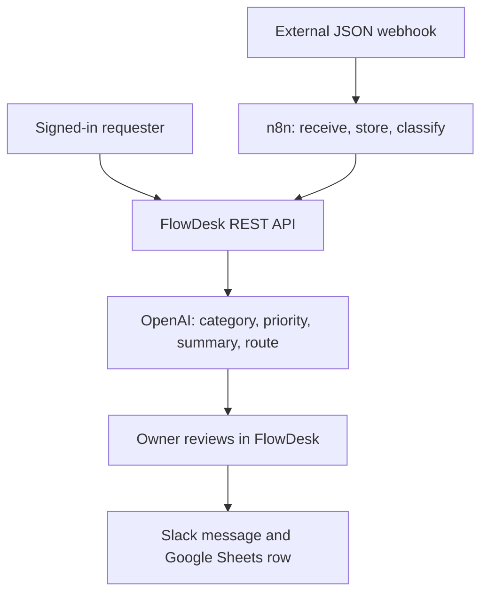
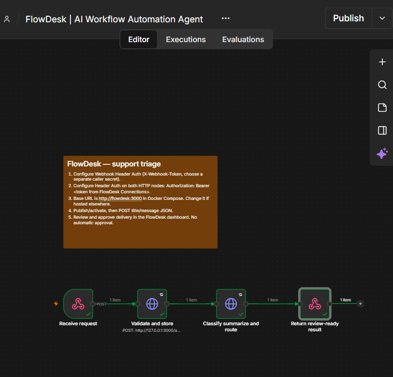
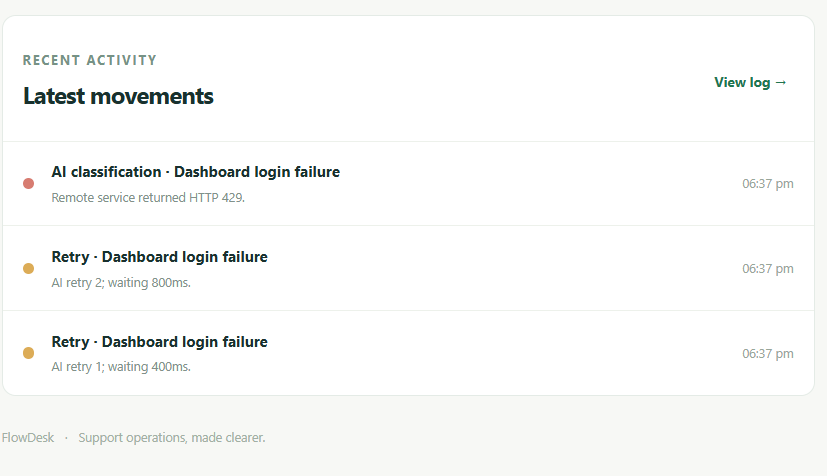

# FlowDesk — AI Workflow Automation Agent

FlowDesk organizes incoming support requests. An authenticated n8n webhook accepts JSON from external systems; people can also submit requests from the web interface. The server uses the OpenAI API to classify each request, set a priority, summarize it, and route it to a support team. A workspace owner reviews the result before approved summaries are sent to Slack and recorded in Google Sheets.

## How it works

The two intake paths converge in the same workspace. n8n authenticates the incoming webhook, calls the FlowDesk REST API to persist the request, calls the classification endpoint, and returns the result. A browser submission calls the REST API directly. FlowDesk stores the request and its execution events in SQLite. Human approval is required for delivery; the suggested reply remains a draft and is never sent to the requester.

## Interface

| View | Purpose |
| --- | --- |
| **Overview** | Shows request totals, high-priority work, the owner’s review queue, and recent activity. |
| **Requests** | Lets requesters submit work and track their own requests. Owners can search the workspace inbox, inspect AI reasoning and the execution trace, and approve delivery. |
| **Activity** | Records receipt, AI classification, routing, approval, retries, and destination outcomes in time order. |
| **Connections** | Lets the owner configure OpenAI, Slack, Google Sheets, and a scoped n8n token. Saved secret values are not returned to the browser. |

Owners create a workspace and invite requesters with a code. Requesters only see their own submissions; owners see the workspace queue. n8n uses a workspace-scoped machine token for intake and classification, without permission to approve delivery.

## Workflow in action

The imported workflow receives a POST request, stores it through the API, classifies and routes it, then returns a review-ready result. The owner performs the final approval in FlowDesk. The screenshot shows a successful test execution; the workflow also supports a published production webhook for subsequent requests while n8n and FlowDesk are running.

The Activity view records individual retry attempts and the final outcome. This screenshot captures a temporary HTTP 429 response; it is an example of a failed run, not a successful delivery. The application retries transient 429/5xx responses with bounded delays and does not blindly repeat an uncertain Slack or Sheets write.

## Implementation

| Part | Technology and responsibility |
| --- | --- |
| Frontend | Responsive HTML, CSS, and browser JavaScript for requester and owner workflows. |
| API and persistence | Node.js HTTP endpoints and SQLite for users, workspaces, requests, settings, and event history. |
| Authentication | Signed HttpOnly browser sessions; separate, scoped webhook token for n8n. |
| AI | OpenAI Chat Completions API with a strict JSON schema and server-side output validation. |
| Automation | Importable n8n webhook and HTTP Request workflow with retry-on-failure settings and an idempotency key for intake. |
| Delivery | Slack Incoming Webhooks and Google Sheets API after explicit owner approval. |

Transient request failures are retried where safe; failures and delivery results remain visible in the request trace. Repeated intake with the same idempotency key returns the existing request, and approvals skip destinations already marked sent. If OpenAI is not connected, requests stay queued rather than receiving a fabricated analysis. If delivery is disabled or a destination is not connected, the result is labeled **Preview only**.

## Run and explore

Requires Node.js 24 or newer. Run `npm run dev`, visit `http://127.0.0.1:3000`, and create an owner account. The owner can invite a requester and configure integrations from **Connections**. Import [`n8n/triage-workflow.json`](n8n/triage-workflow.json) to enable external webhook intake. Docker Compose is also available. Credentials and local database files are not committed.

For exact connection and local n8n instructions, see [Setup](docs/SETUP.md). For endpoints and states, see [API reference](docs/API.md). The [Code walkthrough](docs/CODE_WALKTHROUGH.md) explains the files and design decisions, and [Validation](docs/VALIDATION.md) describes the tests. Run `npm test` and `npm run check` locally.